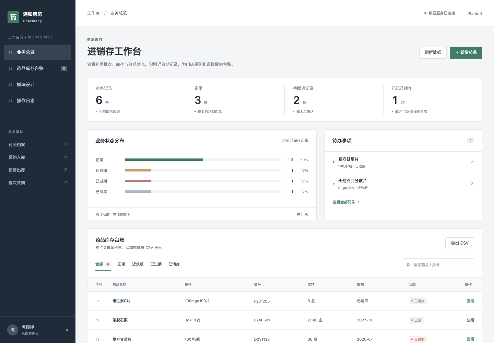

# 基于 Spring Boot 的小型连锁药店进销存管理系统的设计与实现

项目主题：小型连锁药店进销存管理系统（计算机毕业设计演示）。

## 技术栈

- 当前演示：Vue 3、Python、SQLite。
- 选题方案：Vue 3、Spring Boot、SQLite（部分技术尚未接入）。

## 项目功能

支持药品库存台账查询、筛选、维护和 CSV 导出，并记录操作日志。

完整方案规划包括：药品档案、采购入库、销售出库、批次效期、库存盘点、门店调拨、处方登记、经营分析。部分功能尚待开发。

## 运行方式

在项目目录运行 `python3 backend/server.py`，然后访问 http://127.0.0.1:8000。

## 页面展示

## 微信联系

如果需要毕业设计，请扫描下方微信二维码联系。

